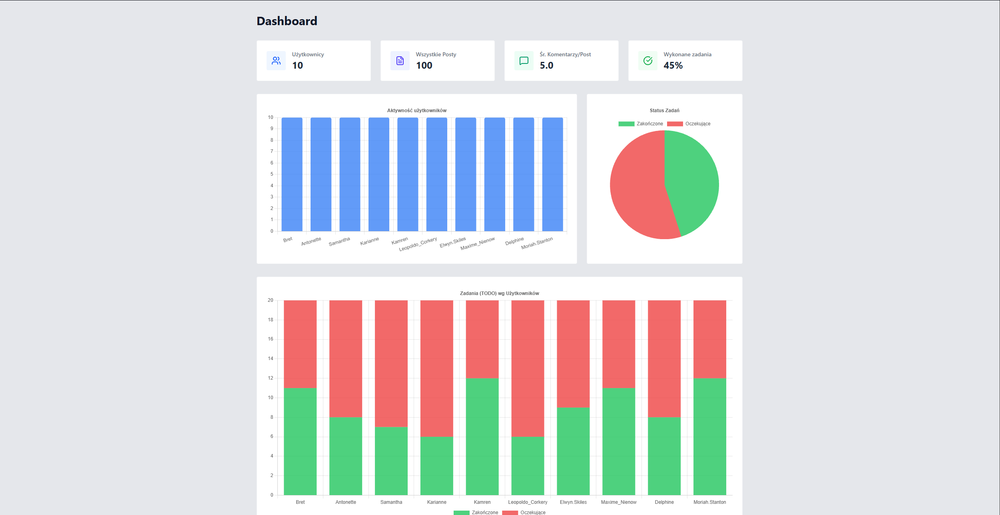

# JSONPlaceholder Analytics Dashboard


Mini-aplikacja analityczna typu Single Page Application stworzona w ramach zadania rekrutacyjnego dla **Cogitech**. Projekt pobiera dane z publicznego REST API (`JSONPlaceholder`), łączy relacje pomiędzy zasobami w czasie liniowym i wizualizuje kluczowe wskaźniki na interaktywnym dashboardzie.

 **Live Demo:** [https://cogitech-task.vercel.app](https://cogitech-task.vercel.app)

---

## Zrzut ekranu



---

## Zrealizowany zakres funkcjonalny

### 1. Pobieranie i integracja danych
Aplikacja komunikuje się równolegle (`Promise.all`) z czterema endpointami API `https://jsonplaceholder.typicode.com`:
- `/users` – dane użytkowników,
- `/posts` – wpisy opublikowane przez użytkowników,
- `/comments` – komentarze przypisane do konkretnych wpisów,
- `/todos` – lista zadań wraz ze statusem ich ukończenia (`completed`).

### 2. Wyliczane metryki i statystyki
- **Łączna liczba użytkowników** w systemie.
- **Całkowita liczba opublikowanych postów**.
- **Średnia liczba komentarzy na post** (zaokrąglona do 1 miejsca po przecinku, z zabezpieczeniem przed dzieleniem przez zero).
- **Wskaźnik ukończenia zadań (Completion Rate)** – procentowy udział wykonanych zadań `TODO` w stosunku do wszystkich.
- **Aktywność publikacyjna per użytkownik** – zmapowanie liczby postów oraz statusów zadań na konkretne nazwy użytkowników (`username`).
- **Top 5 najbardziej komentowanych postów** – ranking wpisów z największą liczbą interakcji.

### 3. Wizualizacje
- **Wykres słupkowy:** Aktywność użytkowników (liczba postów przypadająca na użytkownika).
- **Wykres kołowy:** Globalny stosunek zadań zakończonych do oczekujących.
- **Skumulowany wykres słupkowy:** Szczegółowy rozkład zadań wykonanych i oczekujących w podziale na poszczególnych użytkowników.

---

## Architektura i decyzje techniczne

Projekt został podzielony na czytelne warstwy zgodnie z zasadą **Separation of Concerns**:

```text
src/
├── components/          # Warstwa prezentacji
│   ├── Charts.jsx       # Konfiguracja i komponenty wykresów Chart.js
│   ├── Dashboard.jsx    # Główny widok spinający stan z komponentami UI
│   ├── StatCard.jsx     # Reużywalny komponent karty KPI
│   └── TopPostsList.jsx # Komponent listy rankingowej Top 5 postów
├── constants/
│   └── api.js           # Konfiguracja bazowego adresu URL
├── hooks/
│   └── useApiData.js    # Custom hook zarządzający cyklem życia zapytania (loading, error, refetch, AbortController)
└── utils/
    ├── apiClient.js         # Niskopoziomowy klient HTTP oparty o Fetch API
    ├── dataTransformers.js  # Czyste funkcje (pure functions) agregujące dane + dokumentacja JSDoc
    └── __tests__/           # Testy jednostkowe (Vitest) dla logiki domenowej
```
## Wykorzystanie AI (AI jako *Pair Programming Partner*)
W projekcie wykorzystałem modele LLM nie jako generatory gotowego kodu, lecz w modelu wirtualnego *Pair Programmingu* – do weryfikacji pomysłów, optymalizacji i refaktoryzacji.

Oto główne obszary iteracyjnej pracy z AI:
1. **Złożoność obliczeniowa i optymalizacja ($O(n \cdot m)$ -> $O(n)$):**
   Pierwotny zarys funkcji analitycznych opierał się na podwójnych pętlach (`filter` wewnątrz `map`) w pliku `dataTransformers.js`. Podczas Code Review z AI wyłapaliśmy ryzyko spadku wydajności przy większych zbiorach danych. Przy wsparciu AI zaprojektowałem i wdrożyłem uniwersalnego helpera `countBy`, który korzysta z Hash Mapy, sprowadzając złożoność agregacji danych do liniowej $O(n)$.

2. **Cykl życia Reacta w trybie Strict Mode (plik `useApiData.js`):**
   Konsultowałem z AI architekturę pobierania danych w trybie React StrictMode. Odrzuciliśmy przestarzałe sprawdzanie flagi `isMounted` na rzecz nowoczesnego `AbortController`, co skutecznie anuluje podwójne requesty sieciowe przy odmontowywaniu komponentów . Z pomocą LLM usunąłem również błąd związany z błędnymi zależnościami w tablicy `useEffect` (trigger pattern przy funkcji `refetch`).

3. **Zmysł analityczny i UX:**
   Podczas testów zauważyłem, że JSONPlaceholder dostarcza sztucznie symetryczne dane. AI pomogło mi zweryfikować te anomalie i zaproponowało rozwiązanie UX: dodanie noty uświadamiającej analityka o specyfice danych z API oraz dodanie trzeciego wykresu dla `/todos`, który jako jedyny w tym API cechuje się rzeczywistą zmiennością.

4. **DevOps oraz dokumentacja:**
   AI posłużyło mi jako asystent przy pisaniu pliku YAML dla GitHub Actions (wdrożenie CI pod testy Vitest) oraz pomogło napisać komentarze dokumentacyjne `JSDoc` dla funkcji trensformujących dane.

5. **Wielomodelowa weryfikacja kodu:**
   Projekt poddałem końcowemu audytowi przy użyciu drugiego, niezależnego modelu. Ten etap Code Review pozwolił usunąć pozostałości po starszych standardach, m.in. redundantne deklaracje "use strict" (zbędne w modułach ES), usunięcie pakietów postcss (zbędne przy nowym silniku Tailwind v4) oraz ostateczne wyciągnięcie powtarzalnej walidacji statusów HTTP do czystego helpera apiClient.js.

##  Uruchomienie projektu lokalnie
1.  Repozytorium: `git clone https://github.com/kuben75/cogitech-task.git` 
2.  Zależności: `npm install`
3.  Serwer developerski: `npm run dev`
4. Testy jednostkowe: `npm run test`
